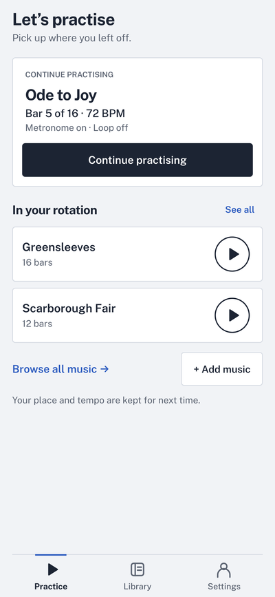
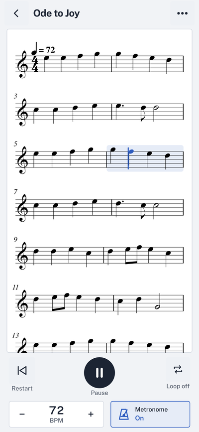
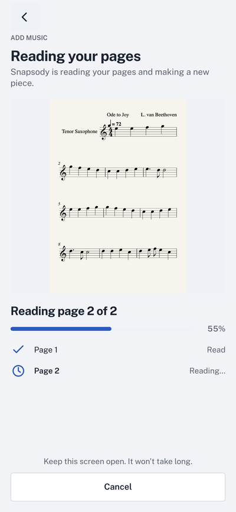
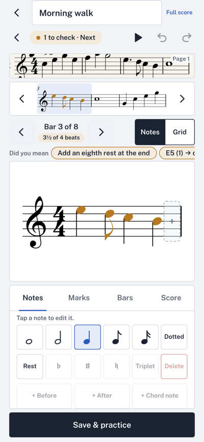

<p align="center">
  
</p>

<h1 align="center">Snapsody</h1>

<p align="center">
  <strong>Snap a photo of your sheet music and practise along with it.</strong><br>
  An offline Android app that reads printed music on the phone and plays it back for you.
</p>

<p align="center">
  <a href="LICENSE"></a>
  
  
  <a href="https://buymeacoffee.com/benvanmierloo"></a>
</p>

<p align="center">
  
  
  
  
</p>

---

## What it does

You're practising from a method book. The exercise on the page has no recording, and you want to
hear how it goes, play along with it slowly, and loop the hard bars. Snapsody does that:

1. **Scan.** Photograph one or more pages with the phone's document scanner.
2. **Read.** Snapsody recognises the notes on the phone itself, with no upload and no account.
   The pages become one piece with continuous bar numbers.
3. **Practise.** It plays the piece with a real instrument sound and follows along in the score.
   You can change the tempo, add a metronome or count-in, and loop a passage with a rest between
   repeats.
4. **Fix.** Recognition isn't perfect, so there is a score editor. It shows one bar at a time,
   large, with the line of your page photo above it, and you change notes, rests, lengths and
   marks with a tap or a drag.

### Features

- **Practice:** follow-along highlighting, restart, play/pause, tempo stepper, metronome,
  count-in and loops with 0/1/2 bars of rest. Each piece remembers its bar,
  tempo, loop and metronome.
- **Library:** all your pieces, plus search, favorites ("in your rotation") and delete.
- **Instruments:** tenor sax, alto sax, clarinet, piano, guitar, violin and trumpet, from sampled
  sounds that ship inside the app. The written notes are never rewritten. Only the sound is transposed for the instrument.
- **Editor:** one bar at a time, as notes on the staff or as blocks on a beat grid. Pitch,
  accidentals, lengths (dotted, triplets), rests, chords, ties, slurs, staccato, tenuto, accent,
  fermata and other marks, crescendo and diminuendo, *pp* to *ff*, breath marks; repeats, first
  and second endings, and adding, splitting, joining and deleting bars; plus key, time signature
  and tempo. It has undo and redo, warns gently about bars that don't add up or notes the reader
  doubted, and offers a fix for a bar that doesn't add up.
- **Language:** English only. There is no language setting.
- **Private by design:** the app has no internet permission. Your pieces, photos and settings
  stay on the device.

### Current limits

- **Android only** (10+, arm64). The architecture keeps an iOS version possible, but there isn't
  one yet.
- **What it reads.** Snapsody keeps every part, staff and voice the reader finds: a melody, a melody
  with a piano accompaniment, or a piano grand staff with chords. Reading piano pages from phone
  photos is newer and less tested than melodies. Lyrics, fingering, pedal marks, 8va lines and
  chord symbols are not read.
- **Scanning needs Google Play services.** The page scanner is Google's ML Kit Document Scanner
  (see [License](#license)).
- Recognition isn't perfect, which is why there is an editor.
- This is early software. Some screens are still waiting for their final design review, and it
  hasn't been released on any store.

## How it works

```
 ┌────────────────────────── Android app (Capacitor) ───────────────────────────┐
 │                                                                              │
 │   web/  (Preact + signals, TypeScript)                                       │
 │     ui/  →  app/  →  core/ (score model, MusicXML, playback)  →  platform/   │
 │                                    │                                         │
 │                       Verovio (wasm) engraves the score                      │
 │                       Web Audio sampler plays the instrument                 │
 │                                    │                                         │
 │   android/  (Kotlin plugins)       ▼                                         │
 │     Scanner ── ML Kit document scanner (capture + crop)                      │
 │     Reader  ── homr optical music recognition in Python (Chaquopy),          │
 │                its neural nets run natively with LiteRT (GPU) / ONNX Runtime │
 └──────────────────────────────────────────────────────────────────────────────┘
```

- **Recognition** uses [homr](https://github.com/liebharc/homr), vendored in `vendor/homr` with
  a small, documented patch set ([`vendor/PATCHES.md`](vendor/PATCHES.md)). The page
  segmentation model is converted to LiteRT and runs on the phone's GPU when a self-test passes,
  falling back to the CPU otherwise.
- **Engraving** uses [Verovio](https://github.com/rism-digital/verovio) compiled to WebAssembly.
- **Playback** is a small sample-based player on Web Audio. The samples come from the
  MIT-licensed MuseScore_General SoundFont, converted at build time by
  `tools/samples/convert_soundfont.py` ([`docs/samples.md`](docs/samples.md)).
- **Layers:** `ui/` → `app/` → `core/` → `platform/` port. The port has three adapters: Capacitor
  (the phone), fake (tests) and browser-dev (desktop Chrome). A test enforces the layer rules.

## Repository layout

| Path | What's there |
|---|---|
| `web/` | The app itself: TypeScript UI, app logic, score and playback core, tests |
| `android/` | Capacitor Android project and the native Scanner, Reader and AtomicFiles plugins |
| `vendor/homr/` | Vendored homr 0.7.1 (AGPL-3.0) with patches |
| `tools/` | Model conversion and packaging, SoundFont conversion, icon and fixture generators, device test script |
| `fixtures/bridge/` | Example messages for the native plugins, shared by the Kotlin and TS tests |
| `openspec/` | Specs, design decisions and their evidence, written with OpenSpec |
| `docs/` | Testing guide, sample notes, design frames and deviations |

## Getting started

### Try the UI in your browser (no phone needed)

Requires **Node 26**.

```sh
cd web
npm ci
npm run dev        # http://localhost:5173
```

This runs the real app with the **browser-dev** adapter. Files live in IndexedDB, "scanning"
opens a file picker, and the reader answers with committed MusicXML, so you can explore
practising, playback and the editor without Android. See
[Running the app in browser-dev](docs/testing.md#running-the-app-in-browser-dev).

### Run the tests

```sh
make test-quick     # web unit tests + Kotlin JVM unit tests (≤ 30 s)
make test-browser   # + UI journeys in headless Chromium via Playwright (≤ 3 min)
make test-device    # end-to-end smoke test on an Android emulator
```

`test-device` also needs an emulator image, the packaged models (see below) and a generated test
page. These are listed under [One-time setup](docs/testing.md#one-time-setup).

The Kotlin part of `test-quick` needs JDK 21, the Android SDK (`ANDROID_HOME`) and a
**Python 3.10** virtualenv at `.venv-py310/`, which Chaquopy uses at build time (for example
`uv venv --python 3.10 .venv-py310`). `test-browser` needs a one-time
`npx playwright install chromium` in `web/`. The full test strategy, including which layer a new
test belongs in, is in [`docs/testing.md`](docs/testing.md).

### Build the Android app

You need **JDK 21**, the **Android SDK** (`ANDROID_HOME`), and Node 26. Then:

1. Install the web dependencies and the Capacitor CLI: `npm ci` in both `web/` and
   `tools/capacitor/`.
2. Create the Python 3.10 virtualenv at `.venv-py310/` (see "Run the tests" above).
3. **Build and package the recognition models.** They are not committed. You need
   **Python 3.12** (for TensorFlow; pass `PYTHON312=<path>` if it isn't on the PATH as
   `python3.12`). Then run:

   ```sh
   make models
   ```

   This downloads homr 0.7.1's three ONNX models from
   [homr's GitHub release](https://github.com/liebharc/homr/releases/tag/onnx_checkpoints) into
   `vendor/homr/` and checks them against `tools/models/pinned_hashes.json`. It sets up the
   conversion toolchain in `.venv-convert/`, converts segnet to LiteRT, makes the GPU self-test
   tile, and packages everything into `android/model-assets/`. The first run downloads about
   1.5 GB and takes a few minutes. A rerun skips every step that is already up to date. If the
   models are missing, `./gradlew assembleDebug` stops and tells you to run it.
4. Build: `cd android && ./gradlew assembleDebug`. This also builds the web layer and syncs it
   into the app.

More detail is in [The Capacitor app](docs/testing.md#the-capacitor-app) and
[One-time setup](docs/testing.md#one-time-setup).

## Contributing

Contributions are welcome, from bug reports and recognition failures to fixes and features.

- **Found a misread score?** Open an issue with a description of the music. Please don't attach
  scans of copyrighted books. See "Test material" below.
- **Before a larger change,** open an issue to discuss it. Design decisions live in `openspec/`.
  [`openspec/changes/archive/2026-11-18-practice-app/design.md`](openspec/changes/archive/2026-11-18-practice-app/design.md) explains
  the current architecture.
- **Keep the tests fast and green.** Run `make test-quick` while you work and `make test-browser`
  before you open a pull request.

### Test material

Committed tests use **only self-made material**: scores generated by the scripts in
`web/test/fixtures/` and `tools/`, and pages engraved from them. Photos of published method books
are copyrighted, so they stay out of the repository. Local tests that need them read from the
git-ignored `fixtures/local/` folder and skip when it's absent.

## Support

Snapsody is free and open source. If it helps your practice, you can
[buy me a coffee](https://buymeacoffee.com/benvanmierloo).

## License

Snapsody is free software under the **[GNU Affero General Public License v3.0](LICENSE)**. It's
AGPL because it includes homr, which is AGPL-3.0.

Third-party components and their licences are listed in [`NOTICE`](NOTICE). Two points to be aware
of:

- **ML Kit Document Scanner** (page capture) is proprietary Google Play services software, not free
  software. It sits behind an interface so an open implementation can replace it, for example for
  an F-Droid build.
- **homr's model weights** were partly trained on datasets with non-commercial terms. That's fine
  for this free app, but needs review before any commercial use.

## Acknowledgements

Snapsody stands on the work of [homr](https://github.com/liebharc/homr) and its contributors, [Verovio](https://github.com/rism-digital/verovio), the
MuseScore_General SoundFont by S. Christian Collins (building on FluidR3 by Frank Wen and
FluidR3Mono by Michael Cowgill), [Chaquopy](https://chaquo.com/chaquopy/),
[LiteRT](https://github.com/google-ai-edge/LiteRT),
[ONNX Runtime](https://onnxruntime.ai/), [Capacitor](https://capacitorjs.com/) and
[Preact](https://preactjs.com/).
